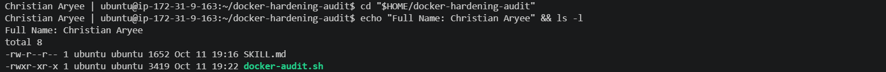
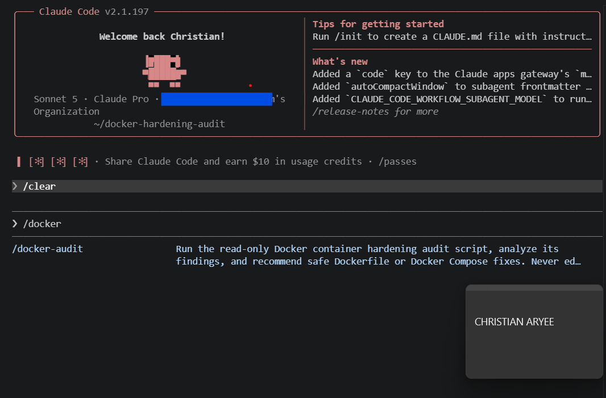
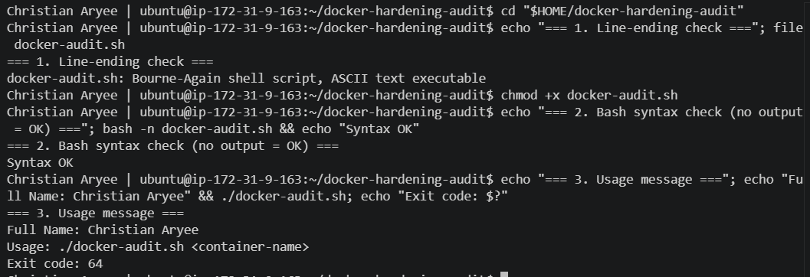
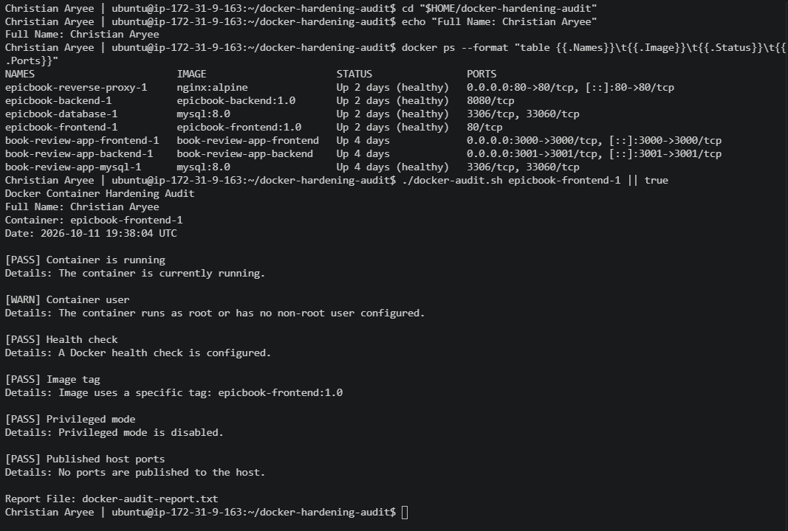
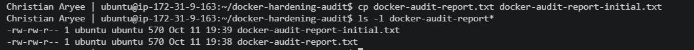
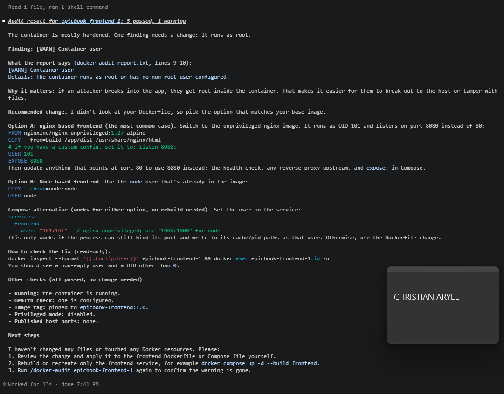
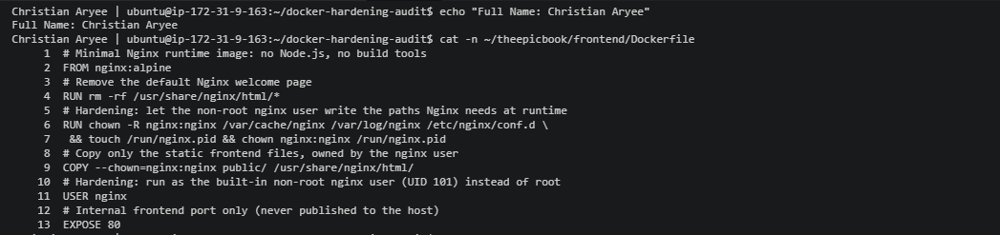
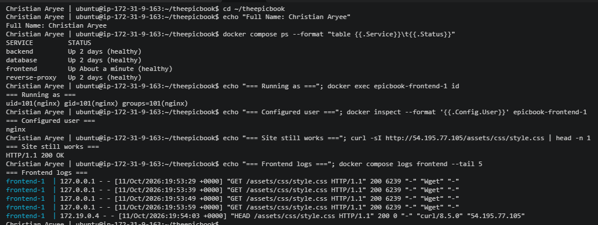
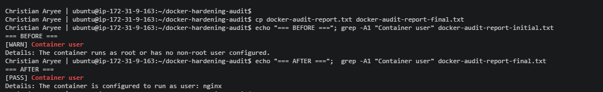
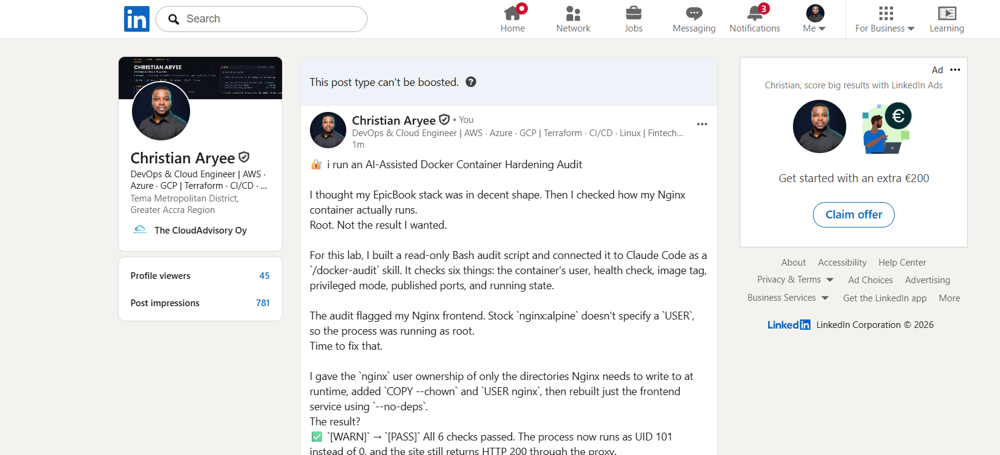

# Assignment 8 — AI-Assisted Docker Container Hardening Audit

Part of the DevOps Micro Internship (DMI) with Agentic AI

---

## Purpose

In this assignment, you will build a read-only Bash script that audits a running Docker container for common hardening gaps — running as root, missing health checks, unpinned image tags, privileged mode, and unnecessary exposed ports — then connect that script to Claude Code as a reusable `/docker-audit` skill. You will run the audit against your production-grade EpicBook stack, fix what it finds by editing the Dockerfile yourself, rebuild the image, and re-run the audit to prove the fix worked. Claude analyzes evidence and recommends a fix; it never edits your Dockerfile or rebuilds the image itself.

---

# Target Container

**Target Container Name:** `epicbook-frontend-1`

- **Stack:** EpicBook production Docker Compose stack (Assignment 07) on AWS EC2, Ubuntu 24.04 LTS
- **Service:** frontend (Nginx serving the static CSS, images and JavaScript)
- **Why this container:** it had a genuine finding (it ran as root with stock nginx:alpine) and I own its Dockerfile. epicbook-backend-1 was already hardened in Assignment 07 (USER node) and has no findings, so no container was weakened to create one.

---

# Task 1 — Prepare the Audit Workspace

## Goal

Create an audit workspace and confirm that the supplied files are available.

### Evidence

#### Screenshot 1 — Audit Workspace Files

Add a terminal screenshot showing your full name and both supplied files:

```text
docker-audit.sh
SKILL.md
```



---

# Task 2 — Add the Docker Audit Skill to Claude Code

## Goal

Add the supplied `docker-audit` skill to Claude Code and confirm that it is available.

### Evidence

#### Screenshot 2 — Docker Audit Skill Available in Claude Code

Add a screenshot of Claude Code showing `docker-audit` in the available skill list.



---

# Task 3 — Validate the Audit Script

## Goal

Verify the audit script line endings, Bash syntax, and usage message.

### Evidence

#### Screenshot 3 — Script Validation

Add a terminal screenshot showing:

- LF line-ending check
- Successful `bash -n docker-audit.sh` validation
- Your full name
- The usage message displayed when the script runs without a container name



---

# Task 4 — Run the Initial Docker Security Audit

## Goal

Audit a running container and record the initial findings.

### Evidence

#### Screenshot 4 — Selected Target Container

Add a terminal screenshot showing:

- Your full name
- `docker ps`
- The audit command using the selected target container name



---

#### Screenshot 5 — Initial Audit Results

Add a terminal screenshot showing the initial Docker audit results.



---

# Task 5 — Use AI Assistance to Understand the Findings

## Goal

Use the supplied `docker-audit` skill to understand the initial audit results safely.

### Evidence

#### Screenshot 6 — Audit Explanation and Recommended Fix

Add a Claude Code screenshot showing:

- Audit finding
- Security risk
- Recommended manual fix
- Verification method



---

# Task 6 — Apply One Container-Hardening Fix

## Goal

Manually fix one WARN or FAIL finding from the initial audit.

### Evidence

#### Screenshot 7 — Hardening Configuration Change

Add a screenshot of the updated Dockerfile or `docker-compose.yml` showing the selected hardening fix.



---

#### Screenshot 8 — Updated Service Running

Add a terminal screenshot showing your full name and the rebuilt or recreated service/container running successfully.



---

# Task 7 — Re-Run the Audit and Compare Results

## Goal

Verify that the selected hardening fix improved the container configuration.

### Evidence

#### Screenshot 9 — Final Audit Results

Add a terminal screenshot showing:

- Your full name
- The updated running container
- The final audit report



---

### Before-and-After Comparison

Write a short comparison covering:

- Initial audit finding
- Dockerfile or Docker Compose change applied
- Final audit result
- Security benefit of the improvement

| | Before (initial audit) | After (final audit) |
|---|---|---|
| **Result** | 5 PASS, **1 WARN** | **6 PASS**, 0 WARN |
| **Container user** | `[WARN]` runs as root (`Config.User` empty) | `[PASS]` runs as user `nginx` |
| **Process identity** | `root` (UID 0) | `uid=101(nginx) gid=101(nginx)` |
| **Site through the proxy** | `200 OK` | `200 OK` (unchanged) |

- **Initial audit finding:** `[WARN] Container user`. `epicbook-frontend-1` was built from stock `nginx:alpine` with no `USER` instruction, so the container process ran as **root** (UID 0). All other checks (running, health check, pinned tag `epicbook-frontend:1.0`, privileged mode off, no published ports) already passed.
- **AI review:** the `docker-audit` skill explained the risk and suggested options. I did not paste them verbatim: Option A assumed a `build` stage my Dockerfile doesn't have and would have moved Nginx to port 8080 (forcing proxy and health-check changes), and the Compose `user:` option fails for stock Nginx because it cannot write its cache and pid files. I adapted the fix to my real file and kept port 80.
- **Change applied (`frontend/Dockerfile`):**
  - `RUN chown -R nginx:nginx /var/cache/nginx /var/log/nginx /etc/nginx/conf.d && touch /run/nginx.pid && chown nginx:nginx /run/nginx.pid` gives the non-root user only the paths Nginx writes at runtime.
  - `COPY --chown=nginx:nginx public/ /usr/share/nginx/html/` makes the served files owned by the serving user.
  - `USER nginx` runs the container as the built-in non-root user (UID 101).
  - Before editing, I confirmed `net.ipv4.ip_unprivileged_port_start = 0` inside the container, so a non-root Nginx can still listen on port 80.
- **Rebuild:** `docker compose up -d --build --no-deps frontend` rebuilt and recreated only the frontend. The backend and database kept their 2-day uptime, so no other service was touched.
- **Final audit result:** `[PASS] Container user — The container is configured to run as user: nginx`. **All 6 checks pass.** `docker exec epicbook-frontend-1 id` returns `uid=101(nginx)`, the service is healthy, and `/assets/css/style.css` still returns `200 OK` through the reverse proxy.
- **Security benefit:** if an attacker ever exploited Nginx or a served file, they would now land as an unprivileged user that cannot install packages, change system files or alter the Nginx configuration, and that has far less leverage for a container escape to the host. The fix shrinks the blast radius at no cost to functionality: same image, same port, same behaviour.

#### Initial audit report (`docker-audit-report-initial.txt`)

```text
Docker Container Hardening Audit
Full Name: Christian Aryee
Container: epicbook-frontend-1
Date: 2026-10-11 19:38:04 UTC

[PASS] Container is running
Details: The container is currently running.

[WARN] Container user
Details: The container runs as root or has no non-root user configured.

[PASS] Health check
Details: A Docker health check is configured.

[PASS] Image tag
Details: Image uses a specific tag: epicbook-frontend:1.0

[PASS] Privileged mode
Details: Privileged mode is disabled.

[PASS] Published host ports
Details: No ports are published to the host.
```

#### Final audit report (`docker-audit-report-final.txt`)

```text
Docker Container Hardening Audit
Full Name: Christian Aryee
Container: epicbook-frontend-1
Date: 2026-10-11 19:56:45 UTC

[PASS] Container is running
Details: The container is currently running.

[PASS] Container user
Details: The container is configured to run as user: nginx

[PASS] Health check
Details: A Docker health check is configured.

[PASS] Image tag
Details: Image uses a specific tag: epicbook-frontend:1.0

[PASS] Privileged mode
Details: Privileged mode is disabled.

[PASS] Published host ports
Details: No ports are published to the host.
```

---

# LinkedIn Requirement

## Goal

Create a LinkedIn post about the container security checks you performed, one hardening improvement you applied, and why the improvement matters.

### Evidence

**LinkedIn Post URL:** `https://www.linkedin.com/posts/caryee_docker-hardening-audit-ugcPost-7515147769326743552-bVms/?utm_source=share&utm_medium=member_desktop&rcm=ACoAACP6ElcBF7-kOglrea_3V5oUhVp4NSh-Trc`

#### LinkedIn Post Screenshot

Add a screenshot of the published LinkedIn post, including the final audit result.



---

# Submission Instructions

- Include Screenshots 1–9 exactly as specified.
- Include the target container name and before-and-after comparison.
- Include the LinkedIn post URL and screenshot.
- Ensure that your full name is visible in all required terminal screenshots.
- Do not expose passwords, API keys, tokens, account IDs, or `.env` file contents.

---

# Completion Checklist

- [x] Audit workspace created and supplied files verified
- [x] `docker-audit` skill added to Claude Code
- [x] Audit script validated successfully
- [x] Running target container identified
- [x] Initial Docker audit completed
- [x] Claude Code explanation of findings captured
- [x] One hardening fix applied manually
- [x] Affected service or container rebuilt and recreated
- [x] Final Docker audit completed
- [x] Before-and-after comparison completed
- [x] Screenshots 1–9 included
- [x] LinkedIn post URL and screenshot included
- [x] No sensitive information exposed

---

## 📌 About DMI & CloudAdvisory

DevOps Micro Internship (DMI) is a project-based DevOps program run by Pravin Mishra (The CloudAdvisory) focused on real-world execution, systems thinking, and career readiness.

It helps learners build strong DevOps foundations with hands-on experience.

---

## 📌 Resources

- 🌐 DMI Official Website: https://dmi.pravinmishra.com?utm_source=github&utm_medium=readme  
- 🎓 University: https://university.pravinmishra.com?utm_source=github&utm_medium=readme  
- 💬 Discord Community: https://discord.pravinmishra.com?utm_source=github&utm_medium=readme  
- 📝 Blog: https://dmi.pravinmishra.com/blog?utm_source=github&utm_medium=readme  
- ▶️ YouTube Playlist: https://www.youtube.com/playlist?list=PLFeSNDtI4Cho  
- 🔗 Pravin Mishra (LinkedIn): https://www.linkedin.com/in/pravin-mishra-aws-trainer/  
- 🏢 CloudAdvisory (LinkedIn): https://www.linkedin.com/company/thecloudadvisory/

---

*This submission is part of DevOps Micro Internship (DMI) — Agentic AI Track.*
