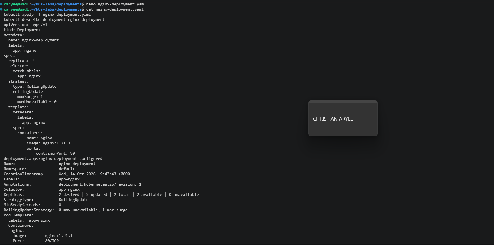
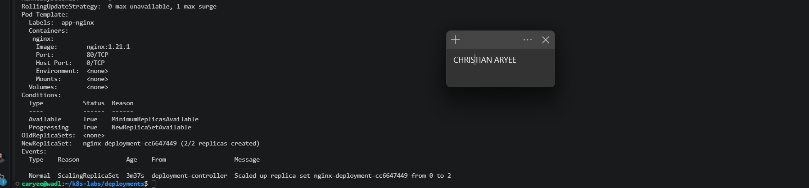
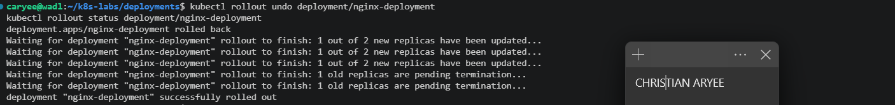
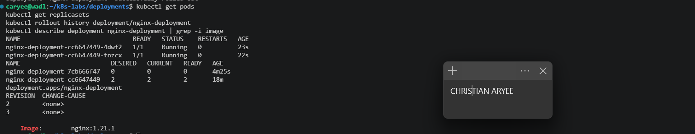
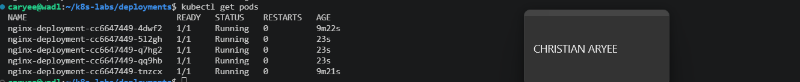
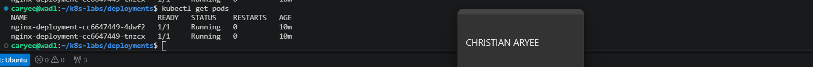

# Assignment 3 — Deployments: From Basics to Rolling Updates

Part of the DevOps Micro Internship (DMI) Cohort 3 with Agentic AI

---

## Purpose

In this guided lab, you will create an NGINX Deployment, add a zero-downtime RollingUpdate strategy, perform an image update, roll it back, and scale the workload.

---

# Task 1 — Set Up the Working Directory

## Goal

Create the `~/k8s-labs/deployments` working directory.

### Evidence

#### Screenshot 1 — Terminal showing the `~/k8s-labs/deployments` working directory

---

# Task 2 — Create the Basic Deployment

## Goal

Create `nginx-deployment.yaml` with two replicas and image `nginx:1.21.1`, apply it, and verify the Deployment, ReplicaSet, and Pods.

### Evidence

#### Screenshot 2 — Manifest plus `kubectl` output showing the Deployment, ReplicaSet, and two Pods

---

# Task 3 — Configure the RollingUpdate Strategy

## Goal

Add `strategy.rollingUpdate` with `maxSurge: 1` and `maxUnavailable: 0` to the Deployment and reapply it.

### Evidence

#### Screenshot 3 — Deployment YAML showing the RollingUpdate strategy and successful apply output

---

# Task 4 — Perform and Roll Back an Image Update

## Goal

Update the image to `nginx:1.23.1` with `kubectl set image`, watch the rollout, then roll it back with `kubectl rollout undo` and check rollout history.

### Evidence

#### Screenshot 4 — Rolling-update status, multiple ReplicaSets, and successful rollback/history output

---

# Task 5 — Scale the Deployment

## Goal

Scale to five replicas, verify, then scale back to two.

### Evidence

#### Screenshot 5 — Terminal showing the scale-up and scale-down results

---

### Notes

Write a short note describing what the lab demonstrated.

This lab showed how a Deployment manages the whole life of an application. I only created the Deployment, and Kubernetes created the ReplicaSet (nginx-deployment-cc6647449) and its two Pods for me, so the chain is Deployment → ReplicaSet → Pods.

I added a RollingUpdate strategy with maxSurge: 1 and maxUnavailable: 0. When I updated the image from nginx:1.21.1 to nginx:1.23.1, the Deployment created a new ReplicaSet (7cb666f47) and swapped Pods one at a time. It started one new Pod, waited until it was ready, and only then removed an old one, so two Pods were always available. The old ReplicaSet was kept at 0 replicas instead of being deleted.

That old ReplicaSet is what made the rollback possible. kubectl rollout undo scaled cc6647449 back up and the new one back down, using the same safe process, and the image returned to nginx:1.21.1. The rollout history showed revisions 2 and 3, because the rollback re-recorded the original version as the newest revision.

Finally, kubectl scale changed the number of Pods to 5 and back to 2 without creating a new ReplicaSet or a new revision, because the Pod template didn’t change. I also learned that kubectl scale doesn’t edit my YAML file, which still says replicas: 2, so reapplying the file would reset the count.

Compared with a plain ReplicaSet in Assignment 02, a Deployment adds safe updates, version history and rollbacks. That’s why it’s the standard way to run applications in production.

---

# Submission Instructions

- Add all required screenshots in your submission
- Include the completed YAML manifests used in the lab

---

# Completion Checklist

- [x] Task 1: Lab directory created (Screenshot 1)
- [x] Task 2: Two-replica Deployment applied (Screenshot 2)
- [x] Task 3: RollingUpdate strategy configured (Screenshot 3)
- [x] Task 4: Image updated and rolled back (Screenshot 4)
- [x] Task 5: Scaled up and down (Screenshot 5)
- [x] Reflection notes written (Notes)

---

## 📌 About DMI & CloudAdvisory

DevOps Micro Internship (DMI) is a project-based DevOps program run by Pravin Mishra (The CloudAdvisory) focused on real-world execution, systems thinking, and career readiness.

It helps learners build strong DevOps foundations with hands-on experience.

---

## 📌 Resources

- 🌐 DMI Official Website: https://dmi.pravinmishra.com?utm_source=github&utm_medium=readme  
- 🎓 University: https://university.pravinmishra.com?utm_source=github&utm_medium=readme  
- 💬 Discord Community: https://discord.pravinmishra.com?utm_source=github&utm_medium=readme  
- 📝 Blog: https://dmi.pravinmishra.com/blog?utm_source=github&utm_medium=readme  
- ▶️ YouTube Playlist: https://www.youtube.com/playlist?list=PLFeSNDtI4Cho  
- 🔗 Pravin Mishra (LinkedIn): https://www.linkedin.com/in/pravin-mishra-aws-trainer/  
- 🏢 CloudAdvisory (LinkedIn): https://www.linkedin.com/company/thecloudadvisory/

---

*This submission is part of DevOps Micro Internship (DMI) Cohort 3 — Agentic AI Track.*
