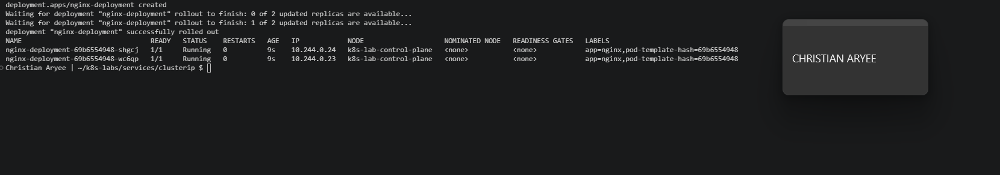
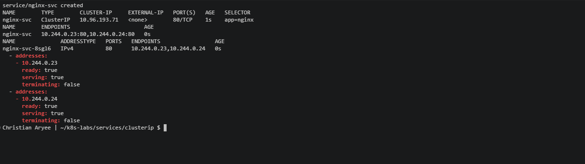
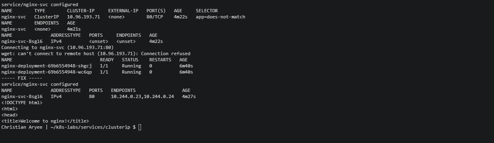
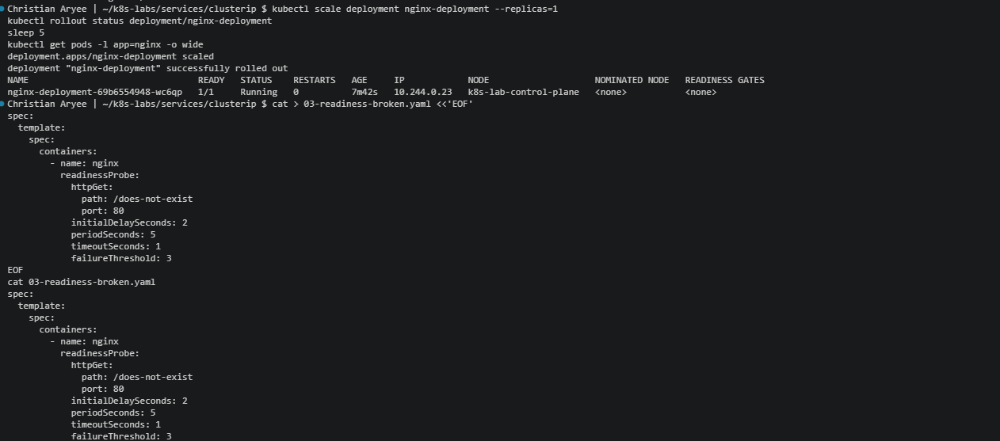
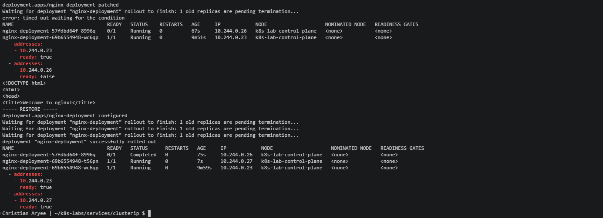
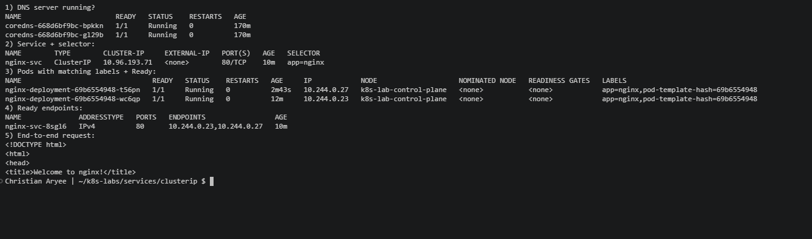

# Assignment 7 — Kubernetes Services (ClusterIP)

Part of the DevOps Micro Internship (DMI) Cohort 3 with Agentic AI

---

## Purpose

In this guided lab, you will create an internal ClusterIP Service for NGINX, call it by DNS and virtual IP, break and fix its selector, and prove readiness-aware endpoint routing.

---

# Task 1 — Deploy the Probed NGINX Workload

## Goal

Create two healthy, labeled NGINX Pods (readiness + liveness probes) as Service backends.

### Evidence

#### Screenshot 1 — Two Ready Pods with labels and IPs

---

# Task 2 — Create and Inspect the ClusterIP Service

## Goal

Create `nginx-svc` (type `ClusterIP`, selector `app: nginx`, port 80) and inspect the Service, Endpoints, and EndpointSlices.

### Evidence

#### Screenshot 2 — Service ClusterIP plus populated Endpoints and EndpointSlices

---

# Task 3 — Call the Service from a Client Pod

## Goal

Create a BusyBox `tester` Pod and call `nginx-svc` by short name, ClusterIP, and both short/FQDN via `nslookup`.

### Evidence

#### Screenshot 3 — Successful `wget` responses and `nslookup` output

---

# Task 4 — Break and Fix the Selector Contract

## Goal

Change the Service selector to `app: does-not-match`, confirm endpoints become empty and requests fail, then restore `app: nginx`.

### Evidence

#### Screenshot 4 — Empty endpoints during failure and restored endpoints after the fix

---

# Task 5 — Prove Readiness-Aware Routing

## Goal

Scale to one replica, apply a broken readiness patch, confirm the NotReady Pod is excluded from Service endpoints, then restore the healthy Deployment.

### Evidence

#### Screenshot 5 — NotReady Pod with excluded endpoint, followed by restored endpoint membership

---

# Task 6 — Troubleshoot and Optionally Clean Up

## Goal

Verify the Service path, then optionally delete `tester` and `nginx-svc`.

### Evidence

#### Screenshot 6 — Final verification or optional cleanup output

---

### Notes

Write a short note describing what the lab demonstrated.

This lab showed how a ClusterIP Service gives a stable internal address to Pods whose IPs keep changing. I deployed two NGINX Pods labelled app=nginx (IPs 10.244.0.23 and .24) with readiness and liveness probes, then created nginx-svc with selector app: nginx. Kubernetes gave it the ClusterIP 10.96.193.71 and automatically listed both Pod IPs as ready: true in its EndpointSlice. From a BusyBox tester Pod, I reached NGINX by short name, by ClusterIP, and through nslookup, where CoreDNS resolved both nginx-svc and nginx-svc.default.svc.cluster.local to the Service IP, not to the Pods. When I changed the selector to app: does-not-match, the endpoints became <none> and requests got “Connection refused”, even though both Pods stayed healthy. Restoring app: nginx brought traffic back instantly, with the same ClusterIP. Finally, with one healthy Pod and a broken readiness patch, the new Pod (10.244.0.26) appeared in the EndpointSlice with ready: false and received no traffic, while requests kept succeeding through the healthy Pod. In short, Services find Pods by labels and route only to Ready ones, which is why selectors and readiness probes matter so much.
---

# Submission Instructions

- Add all required screenshots in your submission
- Include the completed YAML manifests used in the lab

---

# Completion Checklist

- [x] Task 1: Probed NGINX Deployment applied (Screenshot 1)
- [x] Task 2: ClusterIP Service created and inspected (Screenshot 2)
- [x] Task 3: Service reached by DNS and ClusterIP (Screenshot 3)
- [x] Task 4: Selector broken and fixed (Screenshot 4)
- [x] Task 5: Readiness-aware routing proven (Screenshot 5)
- [x] Task 6: Verified / cleaned up (Screenshot 6)
- [x] Reflection notes written (Notes)

---

## 📌 About DMI & CloudAdvisory

DevOps Micro Internship (DMI) is a project-based DevOps program run by Pravin Mishra (The CloudAdvisory) focused on real-world execution, systems thinking, and career readiness.

It helps learners build strong DevOps foundations with hands-on experience.

---

## 📌 Resources

- 🌐 DMI Official Website: https://dmi.pravinmishra.com?utm_source=github&utm_medium=readme  
- 🎓 University: https://university.pravinmishra.com?utm_source=github&utm_medium=readme  
- 💬 Discord Community: https://discord.pravinmishra.com?utm_source=github&utm_medium=readme  
- 📝 Blog: https://dmi.pravinmishra.com/blog?utm_source=github&utm_medium=readme  
- ▶️ YouTube Playlist: https://www.youtube.com/playlist?list=PLFeSNDtI4Cho  
- 🔗 Pravin Mishra (LinkedIn): https://www.linkedin.com/in/pravin-mishra-aws-trainer/  
- 🏢 CloudAdvisory (LinkedIn): https://www.linkedin.com/company/thecloudadvisory/

---

*This submission is part of DevOps Micro Internship (DMI) Cohort 3 — Agentic AI Track.*
