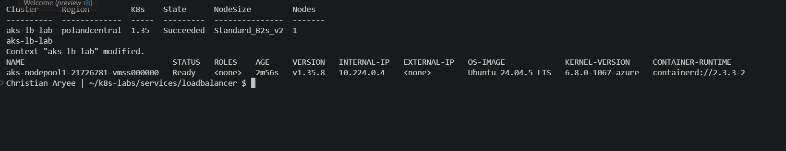
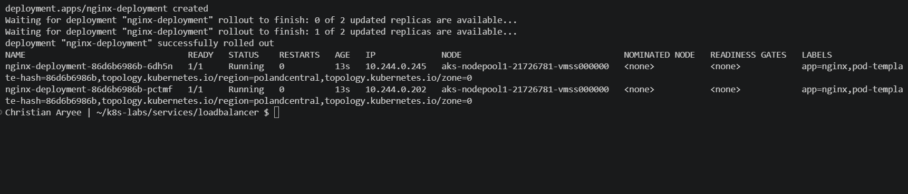
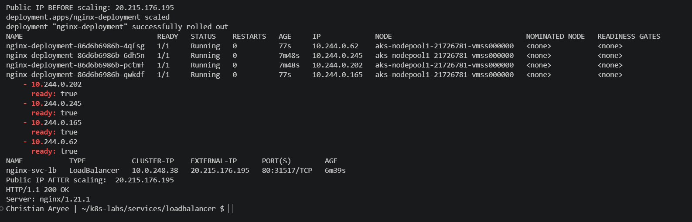
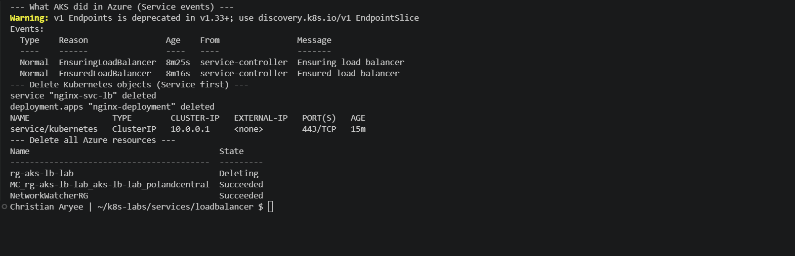

# Assignment 9 — Kubernetes Services (LoadBalancer)

Part of the DevOps Micro Internship (DMI) Cohort 3 with Agentic AI

---

## Purpose

In this guided lab, you will provision a small AKS cluster, deploy probed NGINX Pods, expose them with a public LoadBalancer Service, test the internet endpoint, and observe readiness and scaling.

---

# Task 1 — Provision and Connect to AKS

## Goal

Create resource group `rg-aks-lb-lab` and a one-node AKS cluster `aks-lb-lab` (`westeurope`, `Standard_B2s`), then fetch credentials and verify the node.

### Evidence

#### Screenshot 1 — AKS creation result and Ready node output

---

# Task 2 — Deploy the Probed NGINX Workload

## Goal

Create two healthy, probed NGINX Pods for the public Service.

### Evidence

#### Screenshot 2 — Successful rollout and two Ready Pods

---

# Task 3 — Create and Test the LoadBalancer Service

## Goal

Create `nginx-svc-lb` (type `LoadBalancer`, port 80), wait for `EXTERNAL-IP`, and test it with `curl`.

### Evidence

#### Screenshot 3 — Service with public `EXTERNAL-IP` and successful `curl` output

---

# Task 4 — Prove Readiness Affects Public Traffic

## Goal

Apply a broken readiness patch, confirm the Pod leaves the endpoint set and public availability is affected, then restore health.

### Evidence

#### Screenshot 4 — Endpoint changes and public `curl` behavior before and after recovery

---

# Task 5 — Scale Behind the Stable Public Endpoint

## Goal

Scale to four replicas and confirm the endpoint set grows while the public IP stays the same.

### Evidence

#### Screenshot 5 — Four replicas/endpoints behind the unchanged public endpoint

---

# Task 6 — Troubleshoot and Clean Up

## Goal

Resolve any pending endpoint or unhealthy backend issues, then delete the Kubernetes objects and Azure resource group when finished.

### Evidence

#### Screenshot 6 — Clean final verification or resource deletion command output

---

### Notes

Write a short note describing what the lab demonstrated.

This lab exposed NGINX to the public internet through a Kubernetes LoadBalancer Service on Azure AKS. The README specified westeurope and Standard_B2s, but my Azure for Students subscription only allows five EU regions, and AKS rejected every B-series size in germanywestcentral, where every AKS-allowed size had a vCPU quota of 0. In polandcentral, AKS accepted Standard_B2s_v2, the current-generation equivalent of B2s, so I built the one-node cluster aks-lb-lab there (Kubernetes 1.35.8). Because my Azure CLI is the Windows build, I had to point az aks get-credentials --file at my WSL kubeconfig with wslpath -w. The same probed NGINX Deployment from earlier labs ran unchanged on AKS. Creating nginx-svc-lb with type: LoadBalancer made AKS provision an Azure public IP in under 10 seconds (20.215.176.195), and curl returned HTTP/1.1 200 OK from the internet. The Service also received a NodePort (31517), which is how the Azure load balancer reaches the node. When I rolled out a broken readiness probe, the new Pod (10.244.0.240) appeared in the EndpointSlice with ready: false, and five consecutive public requests still returned 200 through the two healthy Pods. Scaling to four replicas added four ready endpoints while the public IP stayed exactly the same. Finally, I deleted the Service first (so AKS released the Azure load balancer and IP) and then the whole resource group, to stop charges.
---

# Submission Instructions

- Add all required screenshots in your submission
- Include the completed YAML manifests used in the lab

---

# Completion Checklist

- [x] Task 1: AKS cluster provisioned and connected (Screenshot 1)
- [x] Task 2: Probed NGINX Deployment applied (Screenshot 2)
- [x] Task 3: LoadBalancer Service created and tested (Screenshot 3)
- [x] Task 4: Readiness impact on public traffic proven (Screenshot 4)
- [x] Task 5: Scaled behind the stable endpoint (Screenshot 5)
- [x] Task 6: Verified / cleaned up Azure resources (Screenshot 6)
- [x] Reflection notes written (Notes)

---

## 📌 About DMI & CloudAdvisory

DevOps Micro Internship (DMI) is a project-based DevOps program run by Pravin Mishra (The CloudAdvisory) focused on real-world execution, systems thinking, and career readiness.

It helps learners build strong DevOps foundations with hands-on experience.

---

## 📌 Resources

- 🌐 DMI Official Website: https://dmi.pravinmishra.com?utm_source=github&utm_medium=readme  
- 🎓 University: https://university.pravinmishra.com?utm_source=github&utm_medium=readme  
- 💬 Discord Community: https://discord.pravinmishra.com?utm_source=github&utm_medium=readme  
- 📝 Blog: https://dmi.pravinmishra.com/blog?utm_source=github&utm_medium=readme  
- ▶️ YouTube Playlist: https://www.youtube.com/playlist?list=PLFeSNDtI4Cho  
- 🔗 Pravin Mishra (LinkedIn): https://www.linkedin.com/in/pravin-mishra-aws-trainer/  
- 🏢 CloudAdvisory (LinkedIn): https://www.linkedin.com/company/thecloudadvisory/

---

*This submission is part of DevOps Micro Internship (DMI) Cohort 3 — Agentic AI Track.*
