# Assignment 10 — Capstone: Deploy the Book Review App to Kubernetes

Part of the DevOps Micro Internship (DMI) Cohort 3 with Agentic AI

---

## Purpose

In this capstone assignment, you will deploy the Book Review App as a production-style three-tier application on Kubernetes (EKS, AKS, GKE, Minikube, or k3s): a Next.js frontend behind Nginx exposed publicly, an internal Node.js/Express backend on port 3010, and a persistent or managed MySQL database — configured with ConfigMaps, Secrets, and validated end to end.

---

# Task 1 — Prepare the Kubernetes Cluster and Tooling

## Goal

Select a Kubernetes platform, confirm `kubectl` (and Helm, if used) can communicate with the cluster, and verify nodes are Ready.

### Evidence

#### Screenshot 1 — Terminal showing the active Kubernetes context and Ready nodes

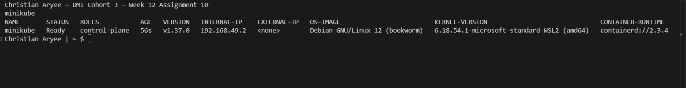

---

#### Screenshot 2 (if using Helm) — Terminal showing `helm version`

   Helm was not used. I deployed with plain YAML manifests and `kubectl apply`, so this screenshot shows the tools I actually used (kubectl, Minikube and Docker).

---

# Task 2 — Design the Three-Tier Kubernetes Architecture

## Goal

Create an architecture diagram showing the public entry point, frontend, internal backend, MySQL, ConfigMaps/Secrets, and the permitted traffic flow.

### Evidence

#### Screenshot 3 — Completed Kubernetes architecture diagram

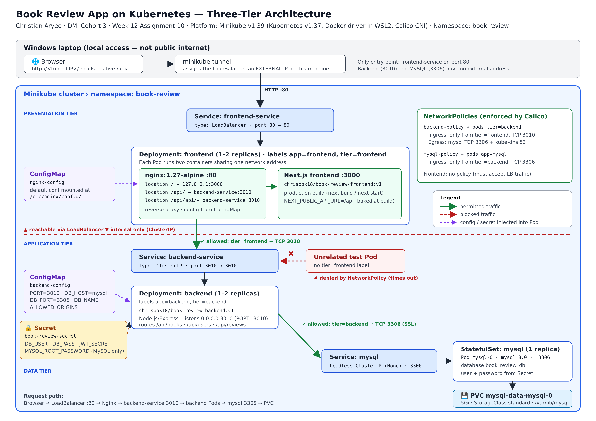

---

# Task 3 — Create ConfigMaps and Secrets

## Goal

Externalize non-sensitive configuration into ConfigMaps and sensitive values (database credentials, JWT secret) into Secrets, referenced from the Pod specs without committing plaintext values.

### Evidence

#### Screenshot 4 — ConfigMap manifest or `kubectl describe configmap` output showing non-sensitive configuration

---

#### Screenshot 5 — Secret object usage with sensitive values hidden or redacted

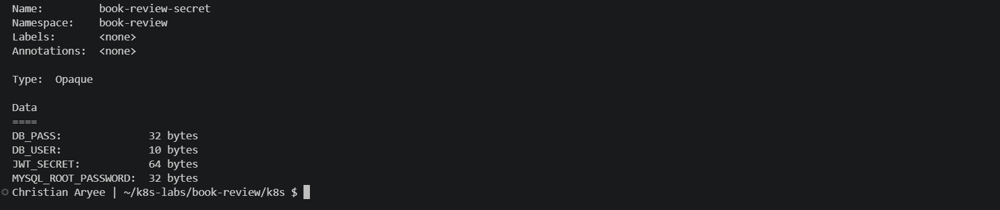

---

# Task 4 — Deploy and Configure the MySQL Data Tier

## Goal

Provide a persistent MySQL database (managed service or StatefulSet + PVC) reachable only by the backend, initialize the schema, and test connectivity.

### Evidence

#### Screenshot 6 — Managed MySQL status or MySQL StatefulSet/PVC status

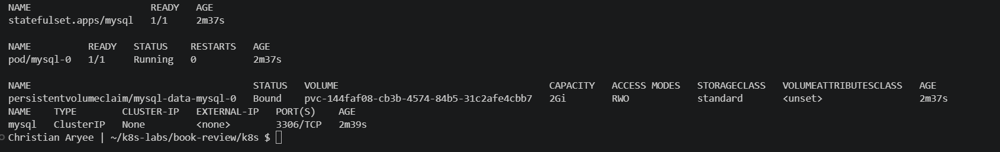

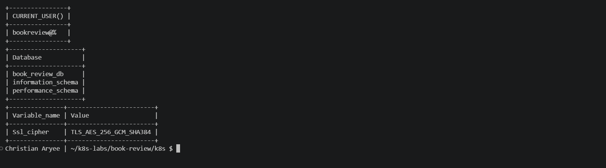

---

#### Screenshot 7 — Successful database connectivity or schema verification with credentials hidden

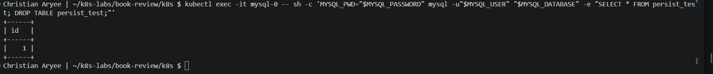

---

# Task 5 — Deploy the Backend Application Tier

## Goal

Run one or two Node.js/Express backend replicas on port 3010, expose them via ClusterIP (or internal LoadBalancer), and connect them to MySQL using ConfigMaps/Secrets.

### Evidence

#### Screenshot 8 — Backend Deployment, Pods, and internal Service

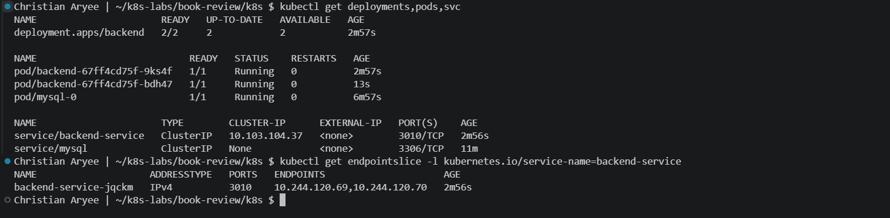

---

#### Screenshot 9 — Backend logs showing successful startup and database connectivity

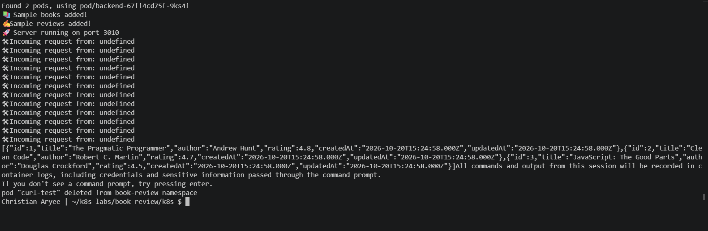

---

# Task 6 — Deploy the Frontend and Configure Nginx

## Goal

Run one or two Next.js frontend replicas behind Nginx on port 80, reverse-proxying to the backend's internal Service name.

### Evidence

#### Screenshot 10 — Frontend Deployment and Ready Pods

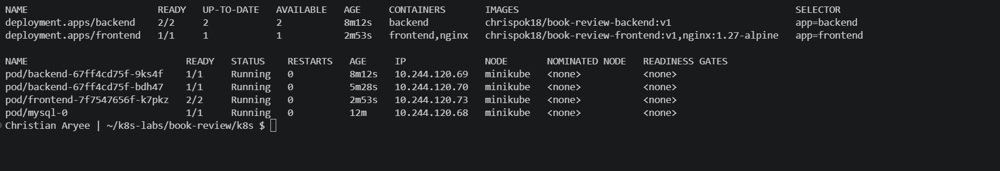

---

#### Screenshot 11 — Nginx reverse-proxy configuration showing the internal backend Service name

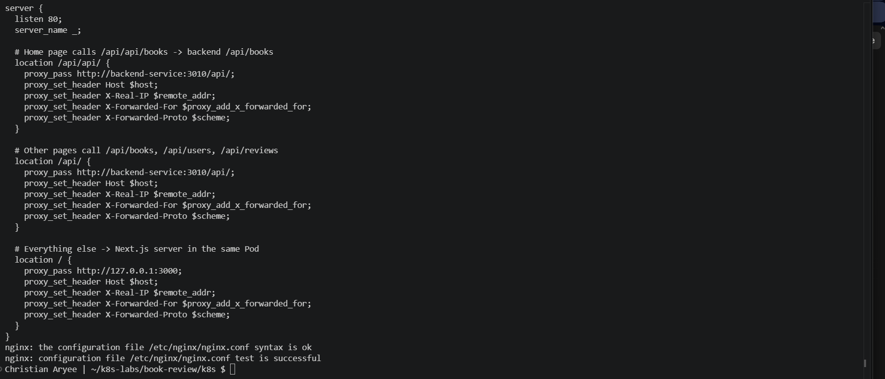

---

# Task 7 — Configure External and Internal Networking

## Goal

Expose only the frontend publicly (LoadBalancer or Ingress), restrict backend access to the frontend path (NetworkPolicy or platform equivalent), and confirm MySQL is not publicly reachable.

### Evidence

#### Screenshot 12 — Frontend LoadBalancer or Ingress showing the public endpoint

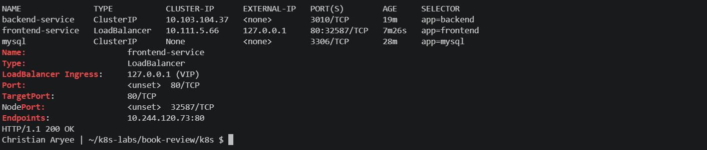

Minikube LoadBalancer Service exposed locally through minikube tunnel (EXTERNAL-IP 127.0.0.1, port 80), reached from the Windows browser at http://localhost via WSL2 localhost forwarding. This is local access, not public internet.

---

#### Screenshot 13 — Internal backend Service and NetworkPolicy (or equivalent restriction)

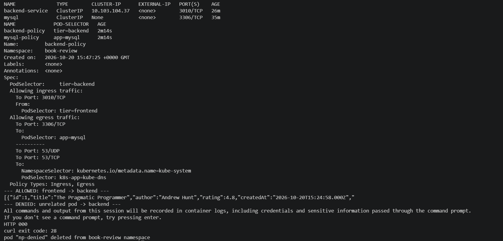

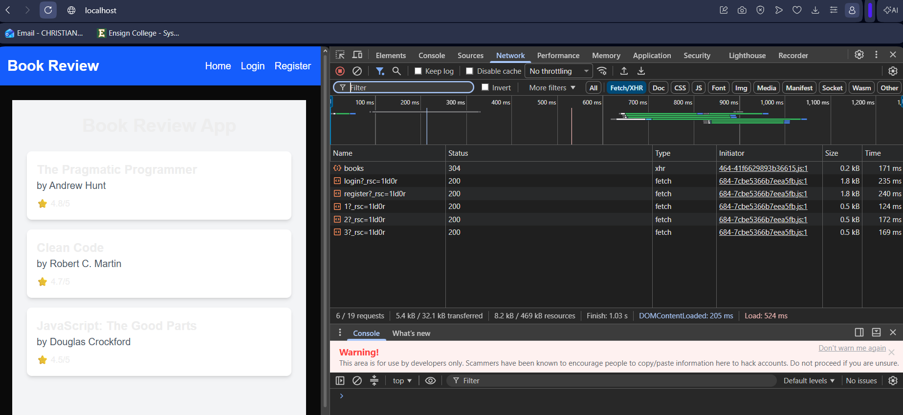

---

# Task 8 — Validate the Application End to End

## Goal

Confirm the frontend loads publicly, a full user flow reaches the backend and MySQL, and collect operational evidence.

### Evidence

#### Screenshot 14 — `kubectl get all` output

---

#### Screenshot 15 — Functional Book Review App in the browser with the public URL or IP visible

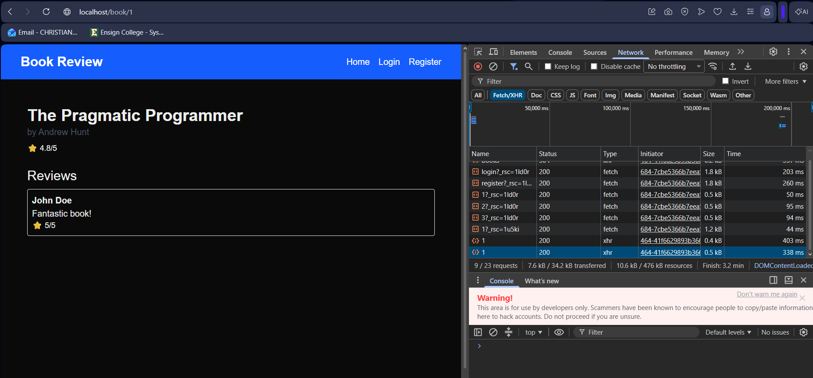

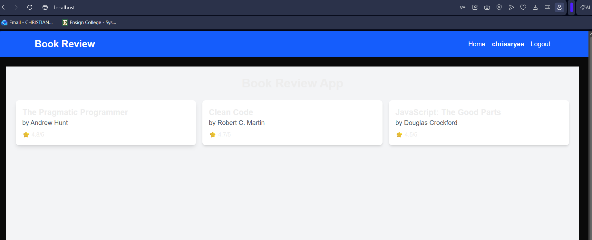

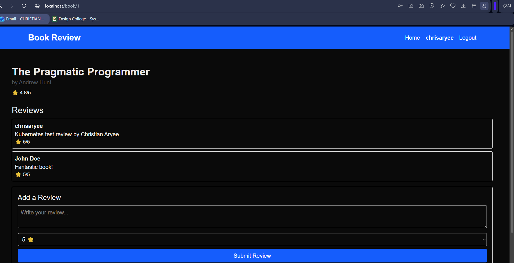

---

#### Screenshot 16 — Frontend Pod logs

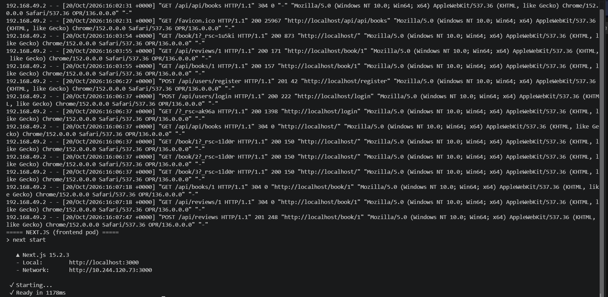

---

#### Screenshot 17 — Backend Pod logs showing successful requests or database activity

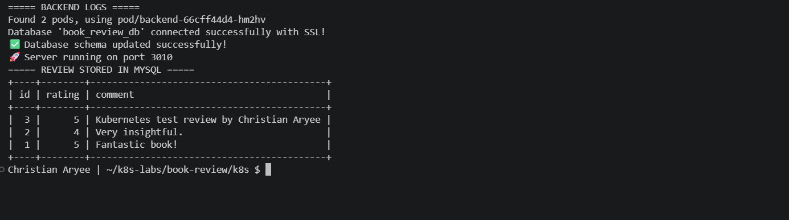

---

#### Screenshot 18 (optional) — Kubernetes dashboard

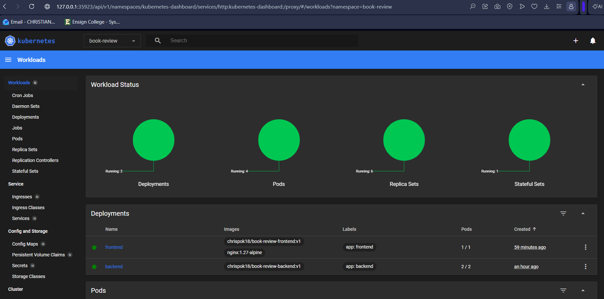

---

# Task 9 — Implement Optional Production Enhancements

## Goal

Optionally package as a Helm chart, add HPA, add readiness/liveness probes, or configure TLS via cert-manager — without changing the core architecture.

### Evidence

#### Screenshot 19 (optional) — Helm release, HPA, probes, or TLS evidence

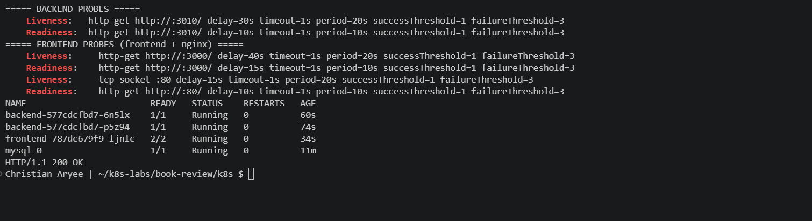

---

### Notes

Report the Kubernetes platform used, the public frontend URL/IP, a GitHub link to your manifests/Helm chart (if applicable), and the architecture diagram link. Summarize what worked, issues encountered and how they were resolved, and the tools/sources that helped the most.

**Platform:** Minikube v1.39.0 running Kubernetes v1.37.0, using the Docker driver inside WSL2 (Ubuntu 24.04). I started it with Calico as the network plugin so my NetworkPolicies would actually be enforced. Namespace: `book-review`.

**Frontend URL / access method:** http://localhost. The frontend is a LoadBalancer Service, and `minikube tunnel` gives it the external IP 127.0.0.1 on port 80. I opened it from my Windows browser through WSL2 localhost forwarding. This is local access only, not the public internet, and it only works while the tunnel is running.

**GitHub manifests:** https://github.com/chrispok18/devops-micro-internship-pravinmishra/tree/main/week-12-kubernetes/manifests/assignment-10-book-review

**Architecture diagram:** [Screenshot 3](screenshots/assignment-10-screenshot-03.png)

**LinkedIn post:** REPLACE_WITH_YOUR_LINKEDIN_POST_URL

**What worked**

I got all three tiers running in the `book-review` namespace. The frontend runs as one Pod with two containers: Next.js on port 3000 and Nginx on port 80. The backend runs two Express replicas on port 3010 behind a ClusterIP Service. MySQL 8.0 runs as a StatefulSet with a 2Gi persistent volume. Settings come from ConfigMaps, and the passwords and JWT secret come from a Secret I never committed or printed on screen. In the browser I could see the books, open a book page, register, log in and post a review. The review was saved in MySQL and was still there after I restarted the backend and even after I deleted the MySQL Pod. My NetworkPolicies let the frontend talk to the backend and the backend talk to MySQL, but a random test Pod timed out trying to reach either of them. I also added readiness and liveness probes to all the app containers.

**Issues I ran into and how I fixed them**

- Minikube wasn't installed in WSL yet, so I installed it first.
- `minikube start --memory=4096` failed because Docker Desktop only gives WSL about 3.8 GB. I dropped it to 3072 MB and kept the resource requests small on every Pod.
- I first pinned Kubernetes v1.30 to match my old kubectl (v1.29), but Calico failed with `undeclared reference to 'isCIDR'`. Its setup needs Kubernetes 1.31 or newer. I deleted the cluster, updated kubectl, and let Minikube use its default version (v1.37).
- kubectl was still pointing at my old AKS context from Assignment 09, which no longer existed. Once Minikube started properly, it switched the context over.
- The repo has a `backend/.env` file with credentials in it, so I added a `.dockerignore` to keep it out of the image I pushed to Docker Hub.
- The repo's frontend Dockerfile runs `npm run dev`, so I wrote a production Dockerfile (`next build` / `next start`) and baked in `NEXT_PUBLIC_API_URL=/api` at build time.
- The `/book/[id]` page is rendered on the server, so a static export wasn't an option. That's why the Next.js server runs behind Nginx instead of Nginx serving static files.
- The home page calls `/api/api/books`, but the other pages call `/api/books`, `/api/users` and `/api/reviews`. I gave Nginx a rule for each pattern so both reach the backend's real `/api/` routes.
- The backend listens on 5000 by default. Setting `PORT=3010` in the ConfigMap is what actually changed it. I then made sure the Service, probes, Nginx and NetworkPolicy all used 3010 too.
- The backend insists on SSL to the database. The official MySQL 8.0 image turns SSL on by default, and I confirmed it with the `Ssl_cipher` check.
- Login and posting reviews would have been blocked by CORS, because `ALLOWED_ORIGINS` was still a placeholder. Once the LoadBalancer was up, I set it to `http://localhost,http://127.0.0.1` and restarted the backend.
- `minikube tunnel` asks for sudo (it needs port 80) and then just sits there. That looked like it was frozen, but it's supposed to stay running.
- The health probes filled the logs with noise, so I used `grep -v` to filter them out and show the real user traffic.
- I scaled the backend to 2 replicas with a command, but my YAML still said 1. I updated the file so GitHub matches what's actually running.

**Tools and sources**

Minikube, kubectl, Calico, Docker Desktop + WSL2, Docker Hub, Nginx, Git/GitHub and Chrome DevTools. I used the Kubernetes docs on StatefulSets, Services, ConfigMaps, Secrets, NetworkPolicies and probes, and the Minikube docs on `minikube tunnel` and Calico. The app's own source code (`server.js`, `db.js`, `api.js`, `page.js`) showed me the real environment variables and API paths. I also used the DMI brief and walkthrough, and Claude as an AI assistant to guide me step by step and help troubleshoot.

**Optional improvements**

I added readiness and liveness probes (Screenshot 19) and captured the Kubernetes dashboard (Screenshot 18). I didn't try Helm, HPA or TLS this time.

**Cleanup plan**

After submitting, I'll delete the `book-review` namespace, stop the tunnel and run `minikube delete` to free up memory on my laptop. It's all local, so there are no cloud costs. The images stay on Docker Hub and the manifests stay on GitHub.

---

# Submission Instructions

- Add all required screenshots and links in your submission
- Do not display decoded Secret values in screenshots or the report

---

# Completion Checklist

- [x] Task 1: Cluster and tooling verified (Screenshots 1–2)
- [x] Task 2: Architecture diagram completed (Screenshot 3)
- [x] Task 3: ConfigMaps and Secrets created (Screenshots 4–5)
- [x] Task 4: MySQL data tier deployed and verified (Screenshots 6–7)
- [x] Task 5: Backend tier deployed internally (Screenshots 8–9)
- [x] Task 6: Frontend deployed behind Nginx (Screenshots 10–11)
- [x] Task 7: External/internal networking configured (Screenshots 12–13)
- [x] Task 8: End-to-end validation completed (Screenshots 14–18)
- [x] Task 9: Optional production enhancements documented (Screenshot 19)
- [x] Report completed (Notes)
- [x] No sensitive information exposed

---

## 📌 About DMI & CloudAdvisory

DevOps Micro Internship (DMI) is a project-based DevOps program run by Pravin Mishra (The CloudAdvisory) focused on real-world execution, systems thinking, and career readiness.

It helps learners build strong DevOps foundations with hands-on experience.

---

## 📌 Resources

- 🌐 DMI Official Website: https://dmi.pravinmishra.com?utm_source=github&utm_medium=readme  
- 🎓 University: https://university.pravinmishra.com?utm_source=github&utm_medium=readme  
- 💬 Discord Community: https://discord.pravinmishra.com?utm_source=github&utm_medium=readme  
- 📝 Blog: https://dmi.pravinmishra.com/blog?utm_source=github&utm_medium=readme  
- ▶️ YouTube Playlist: https://www.youtube.com/playlist?list=PLFeSNDtI4Cho  
- 🔗 Pravin Mishra (LinkedIn): https://www.linkedin.com/in/pravin-mishra-aws-trainer/  
- 🏢 CloudAdvisory (LinkedIn): https://www.linkedin.com/company/thecloudadvisory/

---

*This submission is part of DevOps Micro Internship (DMI) Cohort 3 — Agentic AI Track.*
