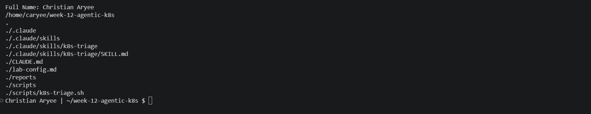
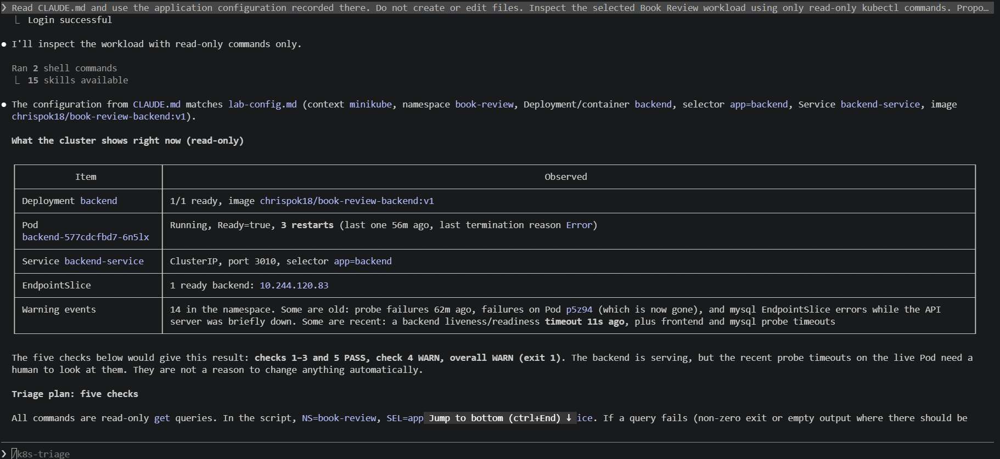
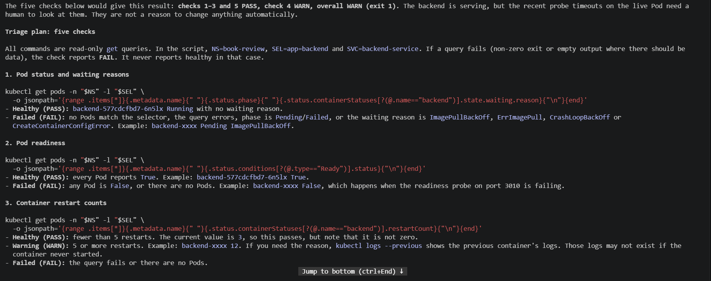
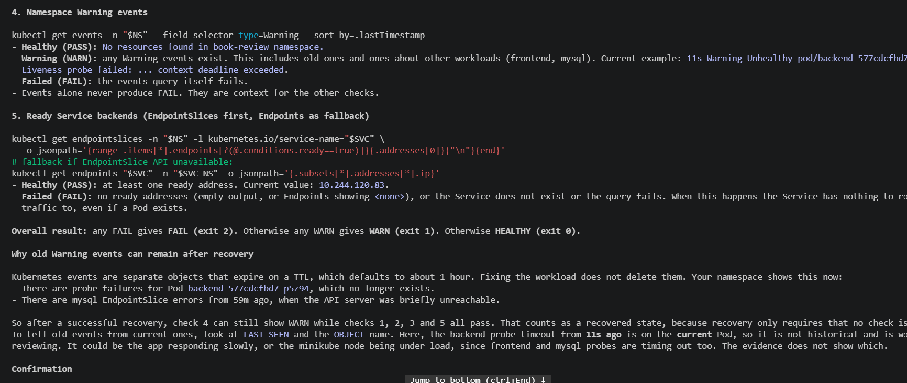
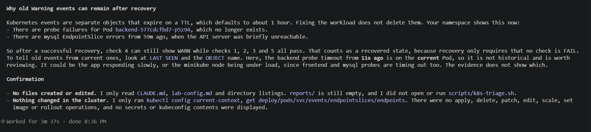
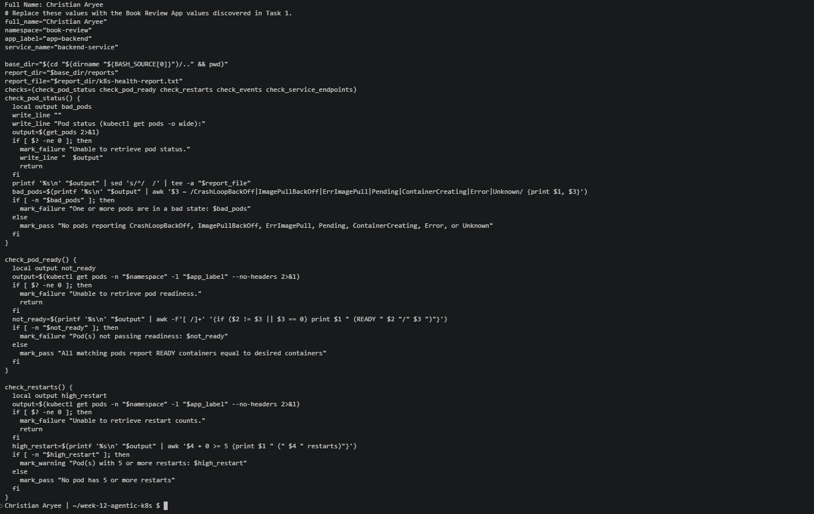
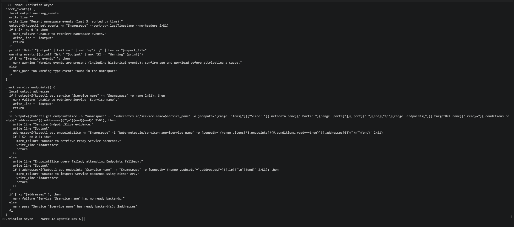
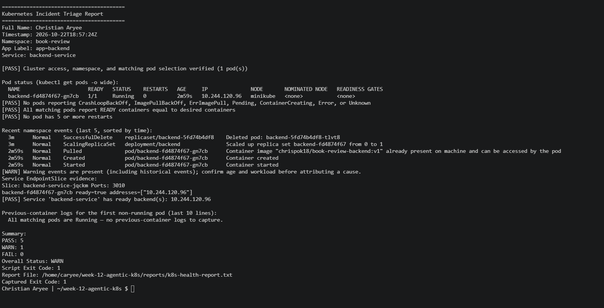
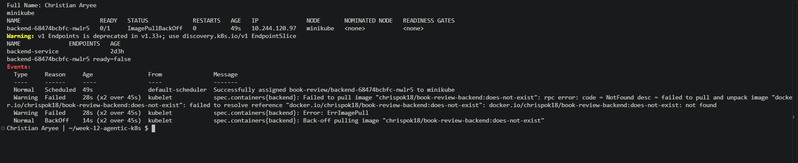

# Assignment 11 — AI-Assisted Kubernetes Incident Triage

Part of the DevOps Micro Internship (DMI) Cohort 3 with Agentic AI

---

## Purpose

In this assignment, you will build a read-only Bash script that checks the health of the Book Review App running on your Kubernetes cluster, connect it to Claude Code as a reusable `/k8s-triage` skill, then deliberately break your own deployment, use the skill to diagnose the failure from evidence alone, recover it yourself, and verify the fix. This closes out the AI Assignment series with the same discipline applied at every layer so far — a single Linux host, two clouds, Terraform, Ansible, a CI/CD pipeline, a Docker image, and now an orchestrated Kubernetes cluster: gather evidence with a read-only tool, let AI analyze it and recommend a fix, keep a human in charge of every action that changes the cluster, and verify again.

---

# Task 1 — Confirm the Healthy Baseline and Create the Workspace

## Goal

Confirm every Book Review App pod is `Running` and `Ready` and that its Service has active Endpoints, then set up a workspace folder for this assignment before writing any automation.

### Evidence

#### Screenshot 1 — `kubectl get pods` and `kubectl get endpoints` showing the Book Review App healthy

---

#### Screenshot 2 — Workspace folder structure for this assignment

---

# Task 2 — Add Safety Rules to CLAUDE.md

## Goal

Add a `CLAUDE.md` telling Claude this is a read-only Kubernetes triage workflow: it must never run `kubectl apply`, `delete`, `rollout restart`, `edit`, or `scale` on its own, and every recovery action must be reviewed and run by you.

### Evidence

#### Screenshot 3 — `CLAUDE.md` showing the project overview, incident workflow, and safety rules

---

# Task 3 — Use Agentic AI to Plan the Triage Checks

## Goal

Ask Claude to propose a read-only, five-check `kubectl` triage plan — pod status, pod readiness, restart counts, recent namespace events, and Service endpoints — before you write any script.

### Evidence

#### Screenshot 4 — Claude's proposed five-check plan, with no file created or cluster state changed

---

# Task 4 — Build the Kubernetes Triage Script

## Goal

Write a Bash script that runs the five read-only `kubectl` checks and writes a PASS/WARN/FAIL report with an overall status and exit code.

### Evidence

#### Screenshot 5 — Script showing the five checks and how each one gathers its evidence

---

#### Screenshot 6 — `bash -n` and `ls -l` confirming the script is valid and executable

---

# Task 5 — Run the Script Against the Healthy Cluster

## Goal

Run the script against your current, unmodified deployment and confirm it reports a clean, healthy baseline before you simulate anything.

### Evidence

#### Screenshot 7 — Script output showing all five checks passing

Baseline result: WARN (exit code 1), PASS 5, FAIL 0. Every check on the live workload passed: the backend Pod was Running and Ready with 0 restarts, and backend-service had a ready backend. The only warning came from the events check. It was caused by historical Warning events from Pods that no longer existed, left over from a cluster restart and my probe-timeout fix. The brief accepts an explained WARN baseline.

---

# Task 6 — Build and Run the /k8s-triage Skill

## Goal

Wrap the script in a Claude Code skill restricted to read-only tools (no `Write`), and confirm `/k8s-triage` reports the healthy baseline using the script's evidence without touching the cluster.

### Evidence

#### Screenshot 8 — `SKILL.md` frontmatter showing the tool restrictions and safety rules

---

#### Screenshot 9 — `/k8s-triage` output for the healthy cluster

---

# Task 7 — Simulate an Incident and Let the Skill Diagnose It

## Goal

Deliberately break your own deployment — an image tag that does not exist, or a misconfigured readiness probe — then run `/k8s-triage` and confirm it correctly identifies the failure, quotes the evidence, and recommends a fix without applying it.

### Evidence

#### Screenshot 10 — The pod in a failed state and the Service showing no Endpoints

---

#### Screenshot 11 — `/k8s-triage` output showing the diagnosis and the recommended `kubectl` command, not executed by Claude

---

# Task 8 — Recover, Verify, and Summarize

## Goal

Review the recommendation, apply the fix yourself, confirm the pod returns to `Running`/`Ready` with active Endpoints, run `/k8s-triage` again to verify, and write a short incident summary.

### Evidence

#### Screenshot 12 — Pod back to `Running`/`Ready` and the Service showing Endpoints again

---

#### Screenshot 13 — Second `/k8s-triage` run confirming recovery

Recovery result: WARN (exit code 1), FAIL 0. The remaining warning comes only from the ImagePull events of the deleted broken Pod backend-68474bcbfc-nwlr5. These events expire on their own after about an hour, so no further action was needed.

---

### Notes

Compare this incident to the Nginx incident from Week 3's AI-Assisted Linux Health Check. What stayed the same about the process, and what changed about the evidence you had to gather?

**What stayed the same:** The process was the same as the Week 3 Nginx incident. I used a read-only Bash script to gather evidence, a Claude Code skill to analyse the report, and a human to make the fix, then ran the same check again to verify. In both cases Claude was only allowed to read and recommend. It suggested the fix as text, and I reviewed and ran it myself. Both times, running the same script before and after the fix gave me a fair comparison between the broken and the recovered state.

**What changed about the evidence:** In Week 3 everything was on one Linux host, so the evidence was simple and direct: whether the service was running, whether the port was listening, whether the HTTP check passed, disk space, and the service logs. In Kubernetes the evidence is spread across several objects that can disagree with each other:
- A Pod can be **Running but not Ready**, so status and readiness had to be checked separately.
- A Service can have **no ready endpoints** even when Pods exist, so I checked the EndpointSlice on its own.
- There were **no logs at all**, because the container never started. The cause only showed up in Pod **events** (`Failed to pull image ... not found`).
- Events are **historical**. They stay for about an hour, even across a cluster restart, so the script WARNs on old events from Pods that no longer exist. Claude had to compare event age and Pod names before blaming anything.
- The fix was also different. In Week 3 I restarted a service directly. Here I changed the **desired state** (the image) and Kubernetes rolled out a new Pod for me.

**Something I learned along the way:** Before the incident, Claude's planning step flagged live probe timeouts. My probes used Kubernetes' default 1-second timeout, which was too short for a small Minikube node, and that was also why the backend had restarts. I raised the timeouts to 5 seconds. I also saw that restarting the backend and MySQL at the same time causes crash loops, because the backend starts before its database is ready.

---

# Submission Instructions

Complete all tasks in sequence.

Your submission must include:
- All 13 required screenshots
- Do not expose kubeconfig contents, cluster certificates, or tokens

---

# Completion Checklist

- [x] Task 1: Healthy baseline confirmed and workspace created (Screenshots 1–2)
- [x] Task 2: `CLAUDE.md` safety rules added (Screenshot 3)
- [x] Task 3: Read-only five-check plan produced before scripting (Screenshot 4)
- [x] Task 4: Triage script built and validated (Screenshots 5–6)
- [x] Task 5: Script run against the healthy cluster (Screenshot 7)
- [x] Task 6: `/k8s-triage` skill built and run against the healthy baseline (Screenshots 8–9)
- [x] Task 7: Incident simulated and correctly diagnosed without being applied (Screenshots 10–11)
- [x] Task 8: Recovery applied by the human, verified, and summarized (Screenshots 12–13, Notes)
- [x] No kubeconfig, tokens, or cluster credentials exposed

---

## 📌 About DMI & CloudAdvisory

DevOps Micro Internship (DMI) is a project-based DevOps program run by Pravin Mishra (The CloudAdvisory) focused on real-world execution, systems thinking, and career readiness.

It helps learners build strong DevOps foundations with hands-on experience.

---

## 📌 Resources

- 🌐 DMI Official Website: https://dmi.pravinmishra.com?utm_source=github&utm_medium=readme  
- 🎓 University: https://university.pravinmishra.com?utm_source=github&utm_medium=readme  
- 💬 Discord Community: https://discord.pravinmishra.com?utm_source=github&utm_medium=readme  
- 📝 Blog: https://dmi.pravinmishra.com/blog?utm_source=github&utm_medium=readme  
- ▶️ YouTube Playlist: https://www.youtube.com/playlist?list=PLFeSNDtI4Cho  
- 🔗 Pravin Mishra (LinkedIn): https://www.linkedin.com/in/pravin-mishra-aws-trainer/  
- 🏢 CloudAdvisory (LinkedIn): https://www.linkedin.com/company/thecloudadvisory/

---

*This submission is part of DevOps Micro Internship (DMI) Cohort 3 — Agentic AI Track.*
